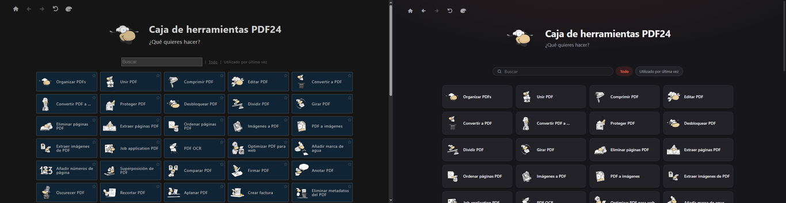
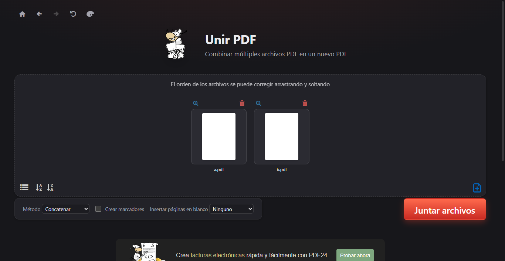
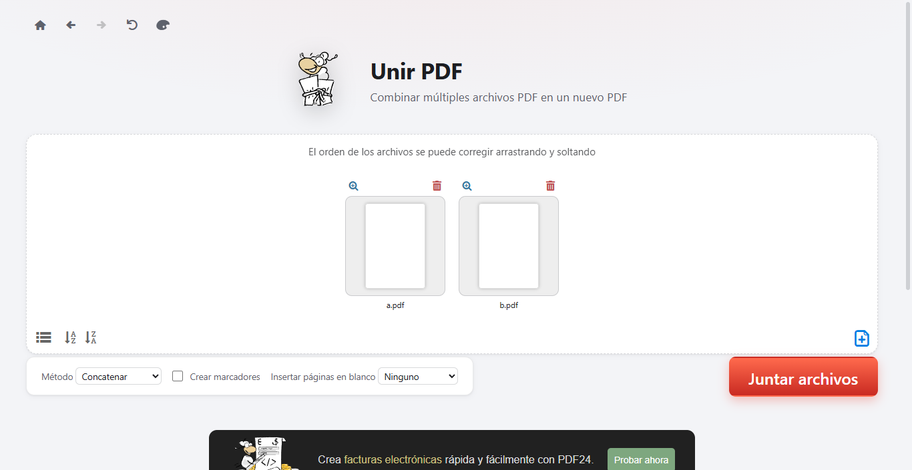
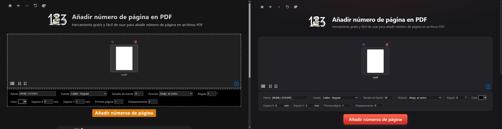
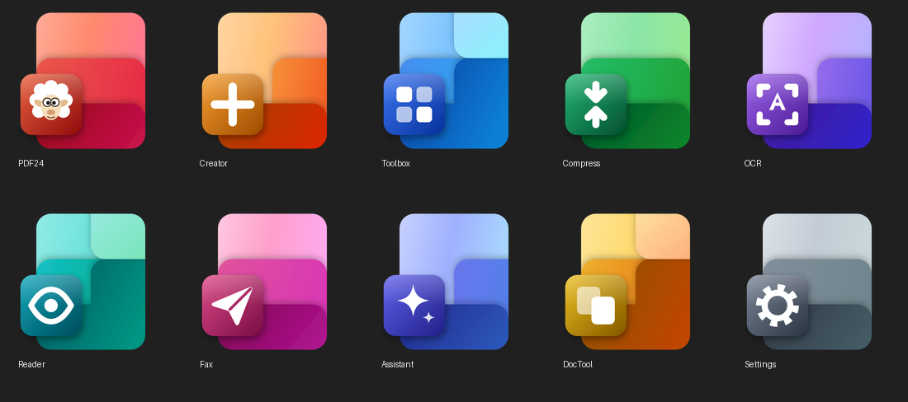
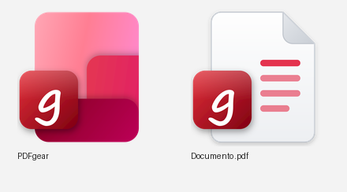

# PDF24 Fluent

A modern, Microsoft 365–inspired look for **PDF24 Creator**: a restyled Toolbox interface plus a matching set of Fluent-style icons for PDF24 and PDFgear.

*[Versión en español más abajo](#español).*



## What's inside

| Folder | Contents |
|---|---|
| `theme/` | `pdf24-fluent.css`, a stylesheet for the PDF24 Toolbox (dark and light themes), and `install-theme.ps1` |
| `icons/` | Icons for PDF24 (main app + 9 tools) and PDFgear (app + `.pdf` document icon) as SVG, PNG 512 px and multi-size ICO, plus `apply-icons.ps1` |
| `tools/` | `generate_icons.py`, the generator for all the icons (Python + Pillow + Inkscape) |
| `screenshots/` | Before/after captures |

## The theme

The PDF24 Toolbox UI is plain HTML/CSS rendered by WebView2 inside `C:\Program Files\PDF24\lib\toolbox`. The theme only **appends CSS** to `css\themes.css`. It doesn't touch any executable or script.

- Rounded tool cards with soft shadows and a hover lift; the favourite star only shows on hover
- Pill-shaped search box and filters
- Clean drop zone and options panel (no more dashed boxes), modern inputs with focus rings
- Coral-red accent gradient for action buttons, Segoe UI typography, thin scrollbars
- Works with both the dark and the light (blue) theme of the palette button

| Dark | Light |
|---|---|
|  |  |



### Install

```powershell
cd theme
powershell -ExecutionPolicy Bypass -File .\install-theme.ps1              # asks for admin rights
powershell -ExecutionPolicy Bypass -File .\install-theme.ps1 -Uninstall   # back to the original
```

Then reopen PDF24 Toolbox. **PDF24 updates overwrite `themes.css`**, so run the installer again after updating. A backup of the original is kept next to it as `themes.css.pdf24-fluent-backup`.

Tested with PDF24 Creator 11.30 on Windows 10.

## The icons

Layered "page" with a glyph badge, in the style of the current Microsoft 365 app icons. Each tool has its own colour and one of three compositions (bands like Word, an L like Excel, steps like OneNote).




### Apply them to your shortcuts

```powershell
cd icons
powershell -ExecutionPolicy Bypass -File .\apply-icons.ps1                # PDF24 / PDFgear shortcuts
powershell -ExecutionPolicy Bypass -File .\apply-icons.ps1 -PdfFileIcon   # + .pdf file icon (if PDFgear is your default PDF app)
powershell -ExecutionPolicy Bypass -File .\apply-icons.ps1 -Revert        # undo
```

The script finds the shortcuts in the Start menu and on the desktops (yours and the shared ones) by their target, backs them up and copies the icons to `%LOCALAPPDATA%\pdf24-fluent`, so you can delete the repo folder afterwards. Shared Start-menu shortcuts need admin rights (a UAC prompt appears).
The icon shown in the taskbar while an app is running comes from its `.exe` and is not changed.

### Regenerate or tweak

```powershell
pip install pillow          # Inkscape must be on PATH
python tools/generate_icons.py out/pdf24 pdf24
python tools/generate_icons.py out/pdfgear pdfgear
```

---

## Español

Un aspecto moderno, inspirado en Microsoft 365, para **PDF24 Creator**: la interfaz de la Toolbox rediseñada y un juego de iconos estilo Fluent para PDF24 y PDFgear.

**Tema de la interfaz.** La Toolbox de PDF24 es HTML/CSS (WebView2) en `C:\Program Files\PDF24\lib\toolbox`. El tema solo **añade CSS** al final de `css\themes.css` y no toca ejecutables. Incluye tarjetas redondeadas con sombra, buscador y filtros en forma de píldora, zona de archivos y panel de opciones limpios, campos modernos, botones con degradado coral y tipografía Segoe UI. Funciona con el tema oscuro y con el claro.

```powershell
cd theme
powershell -ExecutionPolicy Bypass -File .\install-theme.ps1              # pide permisos de administrador
powershell -ExecutionPolicy Bypass -File .\install-theme.ps1 -Uninstall   # vuelve al original
```

Las actualizaciones de PDF24 sobrescriben `themes.css`: vuelve a ejecutar el instalador después de actualizar.

**Iconos.** Una hoja en capas con una placa y un glifo, al estilo de los iconos actuales de Microsoft 365, con un color por herramienta. Para aplicarlos a tus accesos directos:

```powershell
cd icons
powershell -ExecutionPolicy Bypass -File .\apply-icons.ps1                # accesos de PDF24 / PDFgear
powershell -ExecutionPolicy Bypass -File .\apply-icons.ps1 -PdfFileIcon   # + icono de los .pdf (si PDFgear es tu lector)
powershell -ExecutionPolicy Bypass -File .\apply-icons.ps1 -Revert        # deshacer
```

El script busca los accesos directos por su destino, hace copia de seguridad y copia los iconos a `%LOCALAPPDATA%\pdf24-fluent`.

---

## Disclaimer

Unofficial fan project, not affiliated with or endorsed by Geek Software GmbH (PDF24), the makers of PDFgear, or Microsoft.
PDF24 and its sheep mascot, PDFgear, Microsoft 365 and Fluent are trademarks of their respective owners. The sheep in the icons is an original drawing made as a tribute. The tool illustrations visible in the screenshots are part of PDF24 and belong to Geek Software GmbH. This repository does not redistribute any PDF24 or PDFgear files.

## License

[MIT](LICENSE) for the CSS, scripts, generator and icon artwork in this repository.
